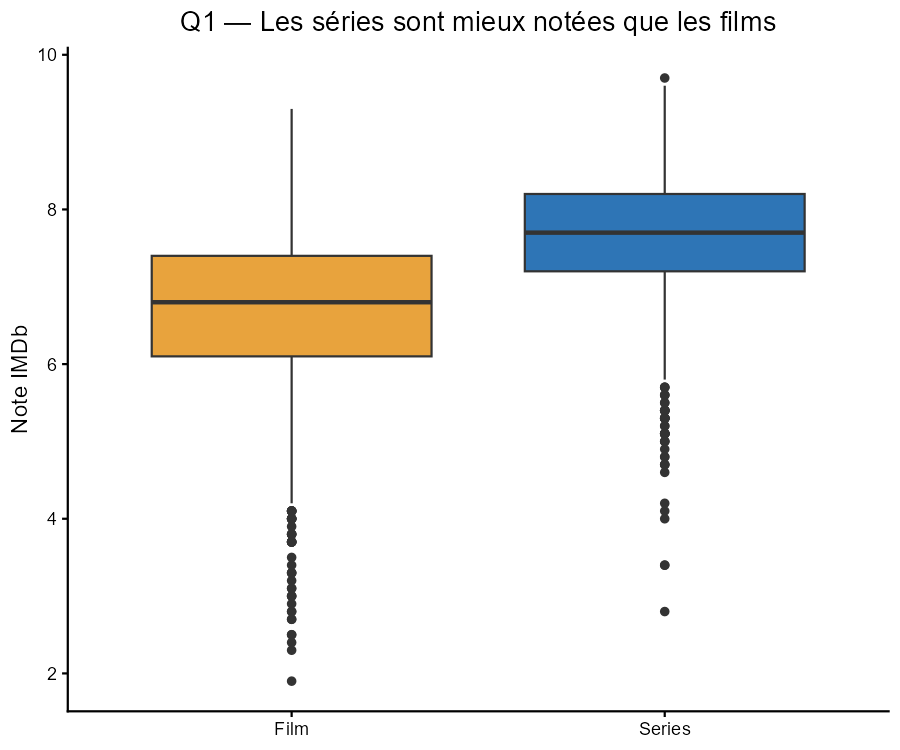
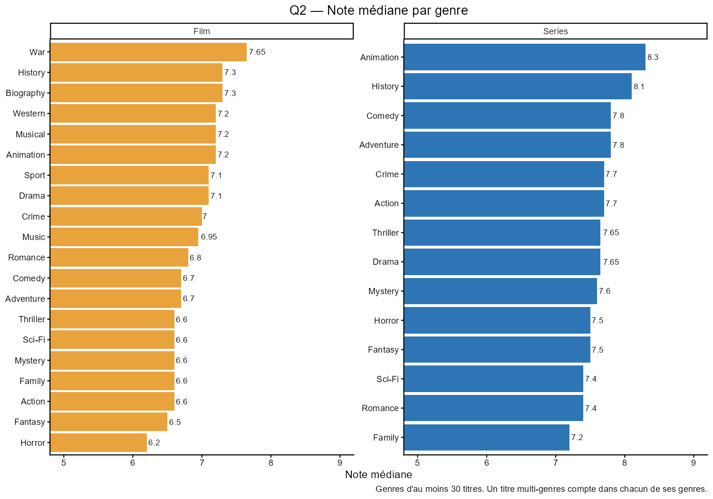
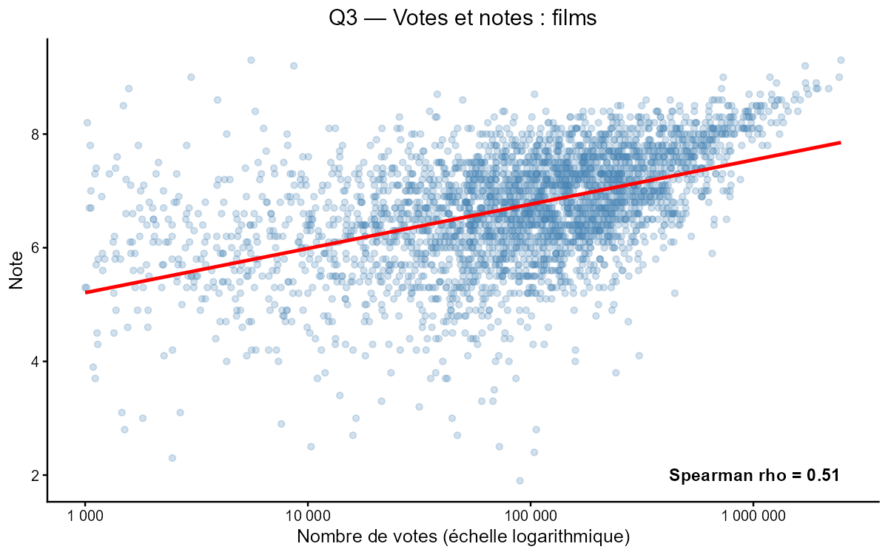
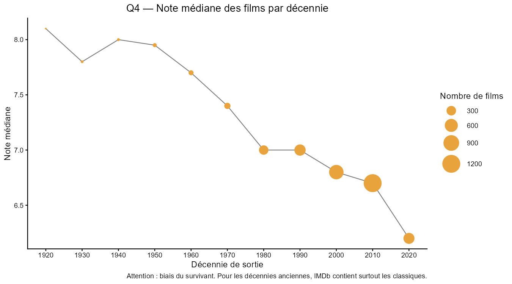
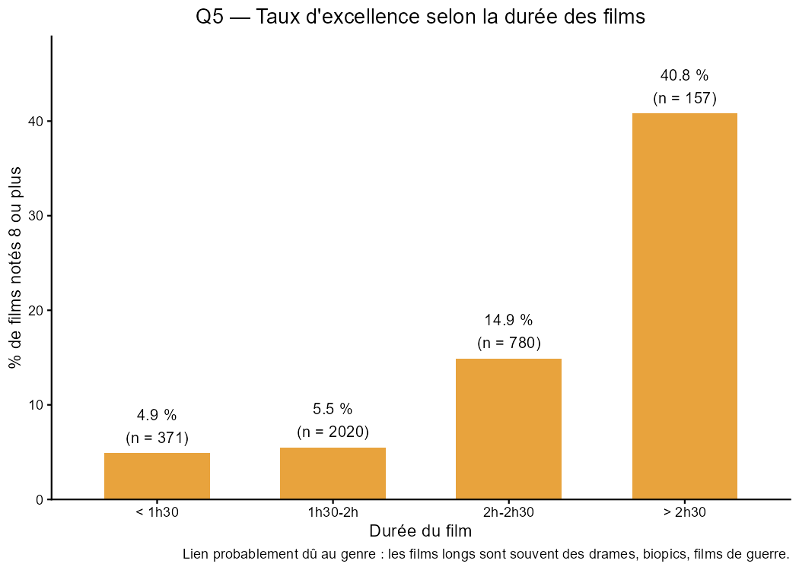

# Analyse statistique des films et séries IMDb avec R

Projet d'analyse d'un jeu de données IMDb (films et séries) réalisé en R. Au départ, c'était un projet suivi dans le cadre de ma formation : un seul script qui enchaînait des tests statistiques un peu au hasard. Je l'ai repris de zéro pour en faire un vrai petit projet d'analyse : un jeu de données plus important, une question métier, un pipeline découpé en étapes, un nettoyage documenté, et des résultats qu'on peut relancer d'une seule commande.

Le script d'origine n'a pas disparu : il est toujours dans le repo, sous [`src/OLD_ANALYSE_BASE_IMDB.R`](src/OLD_ANALYSE_BASE_IMDB.R), pour comparer l'avant/après.

## La question de départ

Je me suis donné un commanditaire fictif : l'équipe acquisition d'une plateforme de streaming, qui se demande **quels contenus privilégier pour que les abonnés soient satisfaits**. J'ai pris la note IMDb comme indicateur de satisfaction, et j'ai découpé la question en cinq :

| # | Question | Indicateurs (KPI) |
|---|---|---|
| Q1 | Films ou séries : lesquels sont les mieux notés ? | note médiane, taux d'excellence |
| Q2 | Quels genres sont les mieux notés ? | note médiane et volume par genre |
| Q3 | Un titre populaire est-il aussi un titre bien noté ? | corrélation de Spearman entre votes et note |
| Q4 | Les films récents sont-ils mieux ou moins bien notés ? | note médiane par décennie |
| Q5 | Existe-t-il une durée de film « idéale » ? | note par tranche de durée |

Les KPI sont définis de la même façon partout :
- **note médiane** : la médiane de `Rate`. Je l'ai préférée à la moyenne parce qu'elle bouge moins avec les notes extrêmes ;
- **taux d'excellence** : le pourcentage de titres notés 8 ou plus ;
- **volume** : le nombre de titres (`n`), pour savoir si un chiffre repose sur 30 titres ou sur 1 500.

J'ai fixé les questions, les KPI et les seuils avant de lancer l'analyse, pour ne pas être tenté de les ajuster en fonction des résultats.

## Les données

Le fichier [`data/raw/imdb.csv`](data/raw/imdb.csv) contient 6 178 lignes et 14 colonnes, avec des titres sortis entre 1922 et 2023 (4 446 films et 1 732 séries avant nettoyage). *(Je n'ai pas noté la source exacte au moment de récupérer le fichier — à retrouver et citer ici.)*

| Variable | Description |
|---|---|
| `Name` | Titre |
| `Date` | Année (pour les séries, ce n'est pas l'année de lancement, voir plus bas) |
| `Rate` | Note moyenne IMDb sur 10 |
| `Votes` | Nombre de votes |
| `Genre` | Un ou plusieurs genres, séparés par des virgules |
| `Duration` | Durée en minutes (pour une série : durée d'un épisode) |
| `Type` | `Film` ou `Series` |
| `Certificate` | Classification (PG-13, R, TV-MA…) |
| `Episodes` | Nombre d'épisodes (vide pour les films) |
| `Nudity`, `Violence`, `Profanity`, `Alcohol`, `Frightening` | Niveau de chaque type de contenu sensible (non utilisés dans cette version) |

Le dossier `data/raw/` contient aussi `Global Internet Users.xlsx`, qui vient d'un autre exercice et ne concerne pas cette analyse.

## Structure du projet

```
IMDb-analyse-BDD-de-films-R/
├── README.md
├── choix.md                     # pourquoi j'ai fait ces choix, dans l'ordre où je les ai pris
├── run_all.R                    # lance tout le projet dans l'ordre
├── IMDb-analyse.Rproj
├── src/
│   ├── 01_import.R              # lit le CSV brut
│   ├── 02_Exploration.R         # découvre les données sans les modifier
│   ├── 03_Nettoyage.R           # produit la table propre
│   ├── 04_Analyse.R             # répond aux 5 questions
│   ├── 05_Figures.R             # une figure par question
│   ├── OLD_ANALYSE_BASE_IMDB.R  # script d'exercice d'origine, conservé pour mémoire
│   └── fonctions/
│       ├── fonctions_nettoyages.R
│       └── fonctions_graphiques.R
├── data/
│   ├── raw/                     # fichier d'origine, jamais modifié
│   ├── processed/                # données intermédiaires (régénérées par run_all.R)
│   └── output/
│       ├── tables/               # résultats des 5 questions (.csv)
│       └── docs/figures/         # figures de la version actuelle (.png)
└── docs/
    └── figures/                  # figures de l'ancienne version d'exercice, pas encore nettoyées
```

Chaque script lit le résultat du précédent, et charge lui-même les fonctions dont il a besoin (pour pouvoir tourner seul). Le chemin `data/output/docs/figures/` est un peu bizarre — c'est resté d'un essai de réorganisation, à corriger (voir « Pistes pour la suite »).

## Lancer le projet

1. Cloner le dépôt et ouvrir `IMDb-analyse.Rproj` (RStudio ou VS Code)
2. Vérifier que `imdb.csv` est bien dans `data/raw/`
3. Installer les packages si besoin :

```r
install.packages(c("tidyverse", "here", "psych", "rstatix", "coin"))
```

4. Dans la console R :

```r
source("run_all.R")
```

Il n'y a pas d'installation automatique des packages pour l'instant : s'ils manquent, le script s'arrête avec une erreur `there is no package called...`, il faut les installer à la main. Les tables de résultats arrivent dans `data/output/tables/` et les figures dans `data/output/docs/figures/`.

## Nettoyage des données

C'est l'étape qui m'a le plus appris. Le détail et le « pourquoi » de chaque choix sont dans [`choix.md`](choix.md), mais voici l'essentiel :

| Étape | Effet | Pourquoi |
|---|---|---|
| Suppression des doublons exacts | −1 150 lignes (6 178 → 5 028) | lignes identiques sur les 14 colonnes, aucune information perdue |
| Retrait des virgules dans `Votes` avant conversion | évite de perdre 96 % des votes | `"107,163"` devenait `NA` à la conversion sans ce correctif |
| Conversion contrôlée en nombre (`Date`, `Rate`, `Votes`, `Duration`, `Episodes`) | 153 valeurs de `Rate`/`Votes` perdues, affichées à l'écran | rendre visible ce qui se perdait en silence avec `as.numeric()` |
| Titres sans `Date`, `Rate` ou `Votes` | −153 lignes (5 028 → 4 875) | titres jamais notés (« No Rate »…), inexploitables |
| Seuil de 1 000 votes minimum | −212 lignes (4 875 → 4 663) | une note donnée par une poignée de votants n'est pas fiable |

**Résultat : 4 663 titres exploitables (3 328 films et 1 335 séries), soit 75 % du fichier de départ.**

Deux découvertes ont changé la suite de l'analyse :
- **Les valeurs manquantes étaient cachées.** `colSums(is.na(df))` affichait 0 partout, parce que les vides étaient écrits en texte (`"No Rate"`, `"-"`). Elles n'apparaissaient qu'à la conversion en nombre.
- **Certains titres existent en deux versions.** *Dynasty*, *Ghosts* et *Twin Peaks* apparaissent deux fois avec le même nom et la même année, mais avec des genres, des durées et un nombre d'épisodes différents. Ce sont des séries différentes (l'originale et un remake), je les ai donc gardées. Ce cas m'a aussi montré que, pour les séries, `Date` n'est pas forcément l'année de lancement.

## Méthode

- **Q1** : test de Welch, test de Mann-Whitney et tailles d'effet (d de Cohen, r). Avec plusieurs milliers de titres, presque tout ressort « significatif ». C'est la taille d'effet qui dit si la différence compte vraiment.
- **Q2** : un titre « Crime, Drama » compte dans les deux genres. Je n'ai gardé que les genres qui ont au moins 30 titres, et je n'ai pas fait un test par genre, pour éviter les faux positifs dus aux comparaisons multiples.
- **Q3** : corrélation de Spearman plutôt que Pearson, parce que les votes sont très inégaux (de 1 000 à plusieurs millions).
- **Q4 et Q5** : **films uniquement**. Pour les séries, `Date` n'est pas fiable et `Duration` correspond à la durée d'un épisode.

## Résultats

### Q1 : les séries sont nettement mieux notées que les films

| Type | Titres | Note médiane | Taux d'excellence |
|---|---|---|---|
| Film | 3 328 | 6,8 | 9,3 % |
| Série | 1 335 | 7,7 | 38,5 % |

L'écart est significatif (test de Welch : t = −30,3 ; p < 0,001) et surtout **grand** : d de Cohen = −0,955. Le test de Mann-Whitney confirme (p < 0,001, r = 0,414, taille d'effet « moderate » au sens de `rstatix`). C'est le résultat le plus solide du projet.



### Q2 : les genres « prestige » en tête, l'horreur loin derrière

Côté films, la guerre (médiane 7,65), la biographie et l'histoire (7,3) et l'animation (7,2) sont les mieux notées. L'action, la science-fiction et le thriller tournent autour de 6,6. L'horreur est dernière avec 6,2, et seulement **1,1 % de films excellents** (7 sur 613).

Côté séries, l'animation domine (médiane 8,3, 72 % de titres excellents), suivie de l'histoire (8,1). Le classement des genres est assez proche entre films et séries, ce qui me rend plus confiant dans le résultat.

À noter : la comédie musicale (31 films), le western (39) et la guerre (46) ont peu de titres. Leur position dans le classement est donc fragile.



### Q3 : un lien moyen entre popularité et note

ρ de Spearman = **0,51** pour les films (p < 0,001) et **0,42** pour les séries (p < 0,001). Les titres les plus votés sont en général mieux notés. Je ne pense pas pour autant que les votes « fassent » la note : c'est plutôt qu'un bon film attire plus de monde, donc plus de votes.



### Q4 : les films anciens sont mieux notés, mais c'est un biais

La note médiane passe d'environ 8 avant 1960 à 6,2 pour les années 2020 (corrélation globale année/note : ρ = −0,29, p < 0,001). Je n'en conclus pas que « le cinéma était meilleur avant ». C'est un **biais du survivant** : pour les années 1940, IMDb n'a gardé que les classiques (13 films dans ce fichier), alors que les années 2010 contiennent de tout (1 203 films). Les décennies avant 1960 ont aussi trop peu de films pour être fiables.



### Q5 : les films longs sont mieux notés, sans doute à cause du genre

| Durée | Films | Note médiane | Taux d'excellence |
|---|---|---|---|
| < 1h30 | 371 | 6,3 | 4,9 % |
| 1h30 - 2h | 2 020 | 6,6 | 5,5 % |
| 2h - 2h30 | 780 | 7,2 | 14,9 % |
| > 2h30 | 157 | 7,8 | 40,8 % |

Le lien est très net (test de Kruskal-Wallis : χ² = 479,67 ; p < 0,001), mais il est probablement dû au genre : les films longs sont souvent des drames, des biopics ou des films de guerre (les genres les mieux notés en Q2), alors que les films courts sont souvent des comédies ou des films d'horreur. Pour le vérifier, il faudrait refaire ce tableau à l'intérieur d'un seul genre. C'est une piste pour la suite.



## Ce que je recommanderais à l'équipe acquisition

| Recommandation | Appuyée par | Confiance |
|---|---|---|
| Privilégier les séries | Q1 (effet grand) | forte |
| Côté films, miser sur le drame, la biographie, l'histoire et l'animation | Q2 (gros effectifs) | forte |
| Acheter des classiques de catalogue | Q4 | moyenne (ceux qui restent sur IMDb sont justement ceux qui ont bien vieilli) |
| Ne pas compter sur l'horreur pour la satisfaction | Q2 | forte (l'horreur peut avoir d'autres intérêts : coût, public fidèle) |
| Utiliser le nombre de votes comme indice de qualité | Q3 | moyenne |
| Préférer les films longs | Q5 | faible (probablement un effet du genre) |

## Limites

- Le fichier est un **extrait** d'IMDb, pas sa totalité : les conclusions valent pour ces 4 663 titres.
- Une note IMDb mesure l'avis des gens qui ont voté, pas une qualité objective. Pour les séries en particulier, on note surtout ce qu'on a regardé jusqu'au bout, donc ce qu'on a aimé. Ça peut gonfler une partie de l'écart avec les films.
- Pour les séries, je ne sais pas exactement à quoi correspond `Date`.
- Les colonnes de contenu sensible (`Nudity`, `Violence`…) ne sont pas exploitées pour l'instant et je ne compte pas le faire pour des raisons personnelles.

## Ce qui a changé par rapport à la première version réalisé via le tuto

| Version d'exercice (`src/OLD_ANALYSE_BASE_IMDB.R`) | Version actuelle |
|---|---|
| Un seul script de 380 lignes | Un pipeline en 6 étapes + `run_all.R` |
| Des questions d'exercice (Chi² films/séries, données simulées) | Cinq questions liées à un besoin métier |
| `as.numeric()` sans contrôle : la plupart des votes perdus | Conversions contrôlées et documentées |
| Filtre au 10e percentile, qui dépend des données | Seuil fixe de 1 000 votes, décidé avant l'analyse |
| « Shapiro non significatif, donc test non paramétrique » | Test de Welch + taille d'effet, adaptés aux grands échantillons |
| Corrélation de Pearson | Corrélation de Spearman, adaptée aux votes très inégaux |
| Graphiques recopiés plusieurs fois | Fonctions réutilisables dans `src/fonctions/` |

Le cheminement complet est expliqué dans [`choix.md`](choix.md).

## Compétences mobilisées

Cadrage d'une question métier et définition de KPI, organisation d'un projet R reproductible (`here`, pipeline découpé en scripts numérotés), exploration et nettoyage de données (typage, valeurs manquantes cachées, doublons, homonymes), statistiques descriptives, tests de comparaison (Welch, Mann-Whitney, Kruskal-Wallis), tailles d'effet, corrélation de Spearman, regard critique sur les biais (survivant, sélection, facteur de confusion), visualisation avec `ggplot2`.

## Pistes pour la suite

- Vérifier l'effet de la durée à genre constant (Q5)
- Ranger le dossier `data/output/` (le chemin `docs/figures` imbriqué dedans est un reste de manip, à simplifier) et nettoyer les anciennes figures dans `docs/figures/`
- Corriger `run_all.R`, qui appelle `04_Analyse.R` deux fois d'affilée pour l'instant
- Exploiter les colonnes de contenu sensible
- Ajouter des tests automatiques sur la table propre (par exemple, aucune note hors de l'intervalle 0-10)
